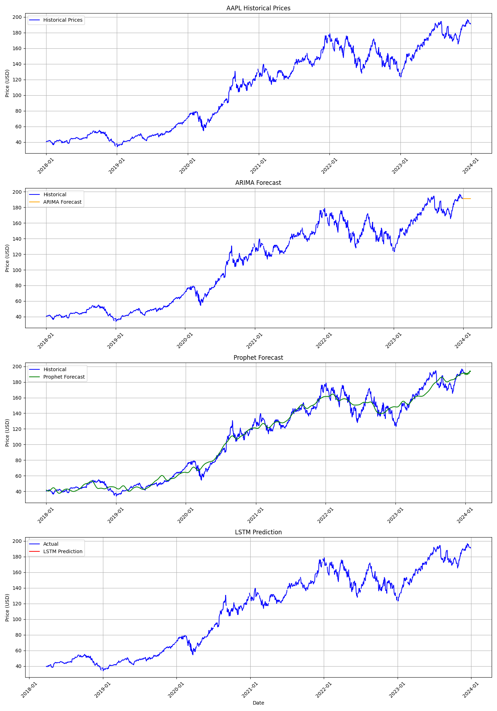
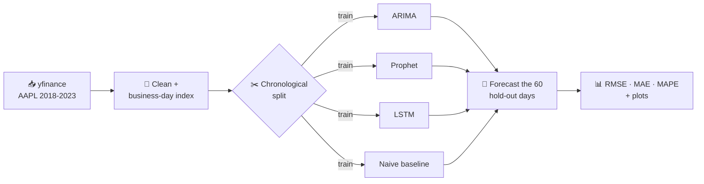
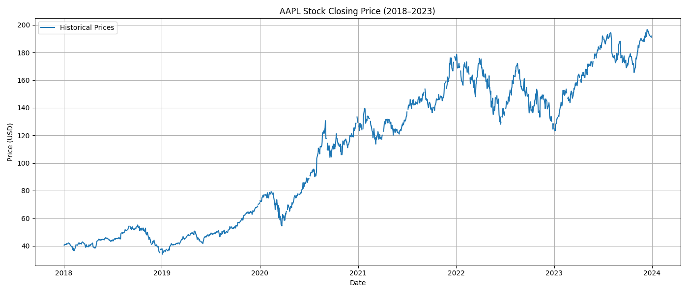
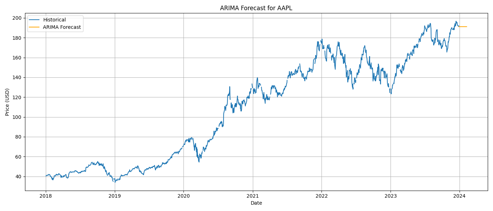
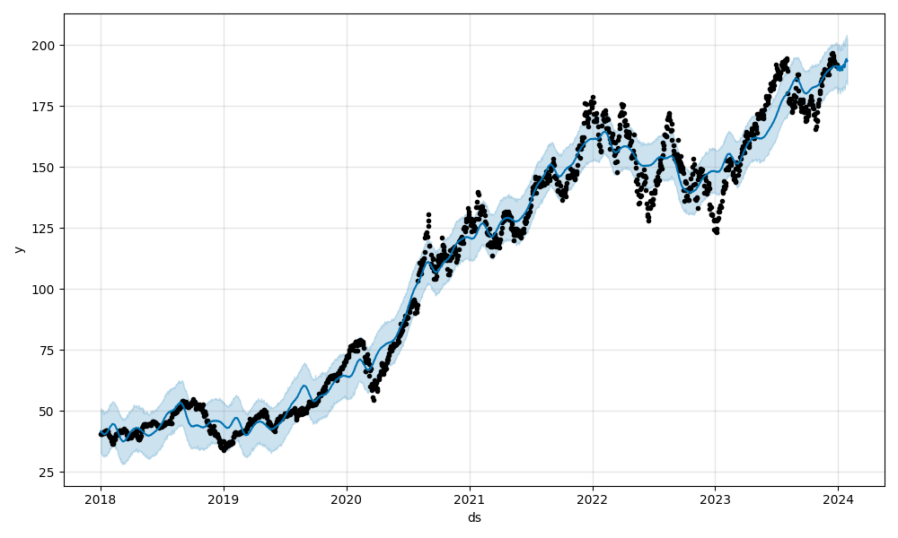
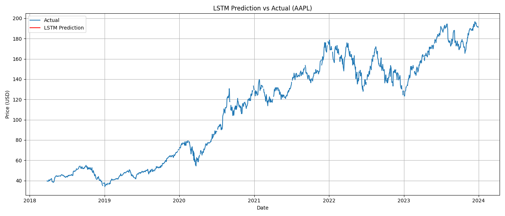

<div align="center">

# 📈 Time Series Stock Forecasting

### ARIMA vs Prophet vs LSTM on AAPL stock prices


*Built during my Data Science & Analytics internship at **Zidio Development** (Jun–Aug 2026)*



</div>

---

## ✨ At a Glance

| | |
|---|---|
| 🎯 **Goal** | Forecast AAPL closing prices and compare three modelling approaches |
| 📊 **Data** | AAPL daily closing prices, 2018–2023 (via `yfinance`) |
| 🧪 **Evaluation** | Chronological hold-out of the last 60 business days, scored with RMSE / MAE / MAPE |
| 🏁 **Baseline** | Naive forecast (tomorrow = today) so every model has something honest to beat |
| 🧰 **Models** | ARIMA(5,1,0) · Prophet · 2-layer LSTM |

---

## 🔄 Pipeline



---

## 🤖 Models Used

| Model | Type | Idea | Setup |
|---|---|---|---|
| **ARIMA** | Statistical | Predicts from its own past values after differencing to remove trend | order `(5, 1, 0)` |
| **Prophet** | Decomposable | `trend + seasonality + holidays`, piecewise-linear trend | default settings |
| **LSTM** | Deep learning | Recurrent network with memory gates, learns from a sliding window | 60-day look-back · 2×LSTM(50) · Adam · early stopping |
| **Naive** | Baseline | Repeats the last known price | n/a |

---

## 🏆 Results

Hold-out period: last 60 business days. Lower is better.

<!-- Run `python main.py`, then paste the numbers from metrics.csv here -->

| Rank | Model | RMSE | MAE | MAPE % |
|:---:|---|:---:|:---:|:---:|
| 1 | _fill in_ | – | – | – |
| 2 | _fill in_ | – | – | – |
| 3 | _fill in_ | – | – | – |
| 4 | _fill in_ | – | – | – |

> [!NOTE]
> Stock prices behave close to a random walk, so beating the naive baseline is genuinely hard. A model that only matches it is an expected result, not a bug.

---

## 🖼️ Plots

<table>
  <tr>
    <td align="center"><b>Historical prices</b><br></td>
    <td align="center"><b>ARIMA</b><br></td>
  </tr>
  <tr>
    <td align="center"><b>Prophet</b><br></td>
    <td align="center"><b>LSTM</b><br></td>
  </tr>
</table>

---

## 🚀 Quick Start

```bash
# 1. Clone
git clone https://github.com/Ayush8356/Zidio_2025_internship_Project.git
cd Zidio_2025_internship_Project

# 2. Install
pip install yfinance pandas numpy matplotlib statsmodels prophet scikit-learn tensorflow

# 3. Run
python main.py
```

Outputs: five PNG plots and `metrics.csv` in the project folder.

---

## 📂 Project Structure

```text
Zidio_2025_internship_Project/
├── main.py                 # Full pipeline: data → models → metrics → plots
├── 1_historical_plot.png   # Train/test split on AAPL history
├── 2_arima_forecast.png    # ARIMA vs actual
├── 3_prophet_forecast.png  # Prophet vs actual
├── 4_lstm_forecast.png     # LSTM vs actual
├── combined_forecast.png   # All plots in one figure
├── metrics.csv             # RMSE / MAE / MAPE per model
└── README.md
```

---

## 🛠 Tech Stack

| Area | Tools |
|---|---|
| Language | Python |
| Data | `yfinance`, Pandas, NumPy |
| Modelling | Statsmodels (ARIMA), Prophet, TensorFlow/Keras (LSTM), scikit-learn (scaling) |
| Visualisation | Matplotlib |
| Version control | Git, GitHub |

---

## ⚠️ Limitations

> [!WARNING]
> Educational project. **Not financial advice** and not a trading tool.

- Single stock (AAPL) and a fixed 2018–2023 window
- ARIMA order `(5,1,0)` was chosen manually, not tuned
- One 60-day hold-out window; no walk-forward validation yet
- Price-only inputs (no volume, indicators or news)

## 🔮 Future Improvements

- [ ] Tune ARIMA with `auto_arima` / AIC
- [ ] Walk-forward (rolling) validation
- [ ] Add volume and technical indicators as features
- [ ] Extend data to the present day and more tickers
- [ ] Streamlit dashboard for interactive forecasts

---

<div align="center">

**Ayush Pal** · B.Tech IT, MAIT Delhi
[GitHub](https://github.com/Ayush8356)

</div>
